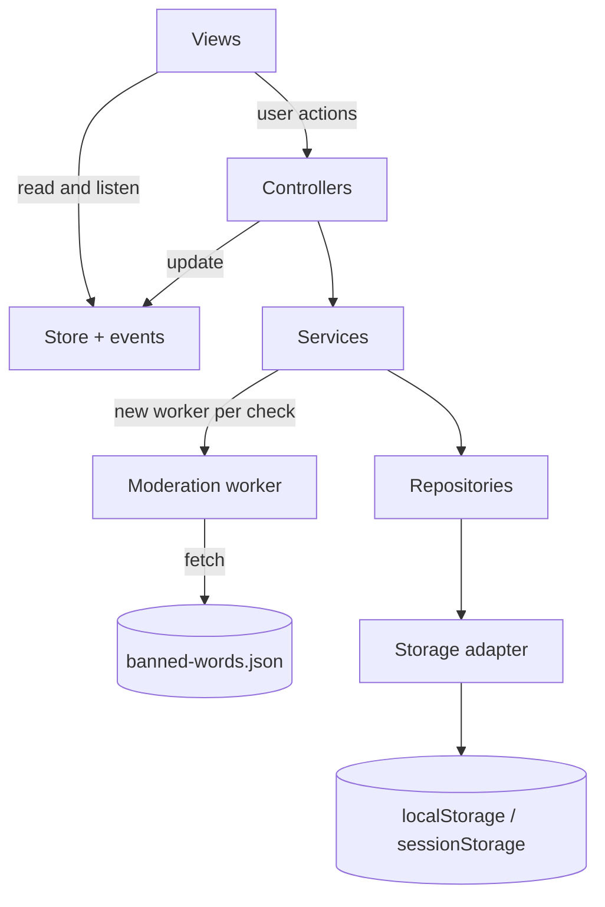

# Comments Page

A threaded comments page in pure HTML, CSS and JavaScript, with no frameworks and no build step.
Users register and log in in the browser, then comment and reply at any depth. Before a comment
is saved, a new Web Worker checks it for banned words in any form.

**Live:** <https://kvetkavojtechova.github.io/CommentsPage/>


The `docs` folder holds the assignment, the specification, the technical design and the
implementation plan.

## Run locally

The page must be served over `http(s)://`. Module scripts, Web Workers, `fetch` and Web Crypto do
not work when `index.html` is opened directly from the file system (`file://`); the page then
shows a short notice instead.

```sh
npm install
npm run serve
```

Then open <http://localhost:3000>. Any static server works as well, for example
`python3 -m http.server` or VS Code Live Server.

## Features

| Assignment                                  | How it works                                                                                                                     |
| ------------------------------------------- | -------------------------------------------------------------------------------------------------------------------------------- |
| Register and log in, stored in the browser  | Users in `localStorage` with hashed passwords; the session in `sessionStorage`, so it ends when the tab closes                   |
| Guests can only read                        | Guests see every comment, but no comment box and no Reply buttons                                                                |
| Anybody can reply, at any depth             | Every logged-in user can reply. Comments are stored as a flat list with a `parentId` and drawn as a tree                         |
| A new Web Worker checks every comment       | Add Comment starts a new worker, which loads `data/banned-words.json`, checks the text and is then closed                        |
| Banned words in any form are blocked        | Case, plurals, nationality forms, accents, look-alike letters, leetspeak, spaced or dotted letters (see [Decisions](#decisions)) |
| The user is told which word they cannot use | An orange `#FF8300` message names every banned word found; the text stays in the box                                             |
| Clean comments are added with a timestamp   | Added under the right parent; the time is shown as "5 min ago", with the full date on hover                                      |
| Layout and style                            | 70% wide and centred, `#F5F5F5` background, Lucida Handwriting at 18px, Reply and Add Comment colours that swap on hover         |

Extras that make the page easier to use, without changing any required behaviour: a login
window, an empty state, a character counter, collapsible replies, thread lines, a "Comment
posted" message, Ctrl/Cmd + Enter to post, keyboard and screen reader support, and a guard
against a held-down key filling the box.

## Architecture

The code is split into layers. Each layer only talks to the one below it, and `main.js` creates
all objects and connects them (dependency injection).



| Folder           | Responsibility                                                                            |
| ---------------- | ----------------------------------------------------------------------------------------- |
| `js/views`       | Build and update the DOM. Never import services or storage (enforced by ESLint)           |
| `js/controllers` | Turn user actions into service calls and update the Store                                 |
| `js/core`        | The Store (app state), a small event bus and the error types                              |
| `js/services`    | Accounts, sessions, comments and moderation. No DOM                                       |
| `js/data`        | Repositories that read and validate stored records; the only code that touches storage    |
| `js/worker`      | The worker and the word matcher. Imports nothing from the page                            |
| `js/utils`       | Small pure helpers: building the tree, validation, time formatting, creating DOM elements |

Design patterns: ES modules, Repository, Adapter (web or in-memory storage, so services are
tested in Node), Dependency injection, Observer (Store events), recursion for the comment tree,
and a Promise wrapper around the worker.

## Security

- **No HTML injection.** All text is added with `textContent` through one helper, `el()`.
  ESLint forbids `innerHTML`, `outerHTML`, `insertAdjacentHTML`, `document.write` and `eval`.
- **Content Security Policy** allows scripts, styles and requests only from the page's own
  origin, so injected or inline scripts do not run.
- **Stored data is validated** on every read. Unknown fields and `__proto__` keys are dropped,
  and invalid records are skipped with a console warning instead of breaking the page.
- **Passwords** are hashed with PBKDF2-SHA-256 (600 000 iterations, a random salt per user)
  using Web Crypto, and are never stored. They need 12–128 characters, must not be a common
  password and must not contain the username.
- **Login** gives the same message for an unknown user and a wrong password, and takes the same
  time for both. After 5 failed attempts the name is locked for 30 seconds, doubling up to 15
  minutes.
- **Sessions** use a random token kept in `sessionStorage`; `localStorage` stores only its
  SHA-256 hash with the expiry time. A session ends after 30 minutes without activity or 8 hours
  in total, and logging out ends it in every tab.
- **Moderation fails closed.** The comment service always runs the check itself. If the worker
  fails or takes longer than 5 seconds, the comment is not saved.

**Honest limits.** There is no server, so everything lives in one browser. Accounts are not
shared between browsers or devices. Anyone with access to the browser's developer tools can edit
`localStorage` directly: add or change comments without the word check, delete accounts or reset
the login counter. The measures above protect against other people's input and keep the code
safe to grow, but a real product would need a server that stores the data and repeats every
check. Also, a CSP set in a `<meta>` tag cannot forbid framing (`frame-ancestors`), and GitHub
Pages does not allow custom headers.

## Decisions

Where the assignment leaves room, these choices apply.

| Topic                    | Decision                                                                                                                                                                                                            |
| ------------------------ | ------------------------------------------------------------------------------------------------------------------------------------------------------------------------------------------------------------------- |
| "Anybody can reply"      | Any logged-in user can reply; guests cannot, as they cannot comment either                                                                                                                                          |
| "In any form"            | Whole-word matching of generated forms and disguised spellings, never a search inside a word, so "software", "award" and "Warsaw" are allowed                                                                       |
| Naming the word          | The message names every banned word found, because the user is told which word they cannot use                                                                                                                      |
| New worker per click     | Started for each Add Comment and closed afterwards, as the assignment says. Reusing one worker would be faster                                                                                                      |
| Where data lives         | Users and comments in `localStorage`, so guests and later visits see them; the session in `sessionStorage`                                                                                                          |
| Password hashing         | Done even though storage is local, because plain passwords should never be stored                                                                                                                                   |
| Enter in the comment box | Enter adds a new line; Ctrl/Cmd + Enter posts                                                                                                                                                                       |
| 500-character limit      | Counts `text.length`, so the counter, `maxlength` and validation always agree; an emoji counts as 2                                                                                                                 |
| Large threads            | 3 replies are shown, then "Show N more replies" (N counts the whole branch); from level 6 the indentation stops and replies say who they answer; past level 10 a branch opens on its own via "Continue this thread" |
| Not built                | Sorting, filtering, editing, deleting and a per-user rate limit, as they are not in the assignment                                                                                                                  |

**Blocked on purpose.** A word filter matches spellings, not meaning. So harmless phrases that
contain a real form of a banned word are blocked: "Star Wars", "Russian doll", "Ukrainian
borscht". This follows "in any form" and the specification ("Russian food" must be blocked).

**Adding a forbidden word.** Add the base word to `data/banned-words.json`, for example
`"Kremlin"`, and add a blocked and an allowed example to `tests/wordMatcher.test.js`. Plurals,
nationality forms and disguised spellings apply automatically. Only a form no rule can derive,
such as the word in another language, needs its own entry.

**Allowing a word that is blocked by mistake.** There is no list of exceptions, to keep the rules
simple. If ordinary words written next to each other are joined into a banned word, add the first
one to `COMMON_WORDS` in `js/worker/wordMatcher.js` (this is how "put in" stays allowed). For any
other case, adjust the rule and add the word to the tests.

## Development

Requires Node 20.19, 22.13 or newer. The dependencies are development tools only; the page itself
has none.

| Command                | What it does                      |
| ---------------------- | --------------------------------- |
| `npm test`             | Runs the unit tests (`node:test`) |
| `npm run lint`         | Runs ESLint                       |
| `npm run format`       | Formats all files with Prettier   |
| `npm run format:check` | Checks the formatting             |

To check the drawing speed, start the server and open <http://localhost:3000/tests/perf.html>.
It draws 1 000 generated comments and shows the time.

## Verification

Checked in Chrome on 6 November 2026.

**Security** (spec §12)

| Test                                                                                    | Result                                                        |
| --------------------------------------------------------------------------------------- | ------------------------------------------------------------- |
| Comments ``, `<script>`, `javascript:` link, `<svg onload>` | Shown as plain text; no elements created, nothing runs        |
| Username `<script>alert(1)</script>`                                                    | Refused by validation; nothing saved                          |
| Corrupted storage: invalid JSON, wrong types, a `__proto__` key                         | Page loads without errors; no prototype pollution             |
| Normal use (register, post, blocked word, reply, collapse, log out, reload)             | No CSP violations; an injected inline script is blocked       |
| `userId` in sessionStorage changed to another user, forged token, invented session      | Logged out; never acts as the other user                      |
| 5 wrong passwords                                                                       | Even the right password is refused: "Try again in 30 seconds" |

**Performance** (spec, Performance)

| Target                              | Result                                                                                                     |
| ----------------------------------- | ---------------------------------------------------------------------------------------------------------- |
| 1 000 comments draw in under 200 ms | 97–161 ms over 5 fresh loads, median 103 ms (style and layout included)                                    |
| First load under 100 KB             | 43 KB transferred (gzip), 46 KB after the first comment adds the worker and word list; 131 KB uncompressed |
| No external requests                | None: 40 files, all from the same origin                                                                   |

## Known limitations and next steps

- **Colour contrast.** The assignment requires the banned-word message in `#FF8300` (about 2.3:1
  on its background) and the Add Comment text in `#DE5050` (about 3.9:1 on white). Both are below
  WCAG AA (4.5:1) and are kept as required. The message also has a warning icon and a pale
  orange background, so it does not rely on colour alone.
- **Font.** Lucida Handwriting is installed on Windows only. Other systems use the closest
  handwriting font they have (Segoe Script, Bradley Hand, Apple Chancery, then any cursive font).
- **Word filter trade-offs.** Besides the phrases blocked on purpose, a stretched word with only
  one extra letter, such as "warr", is not caught, so that normal double letters stay allowed.
- **Browser-only data.** See the honest limits under [Security](#security).
- **Next steps:** a small backend for shared accounts and comments, editing and deleting your own
  comments, a rate limit against spam, and loading long discussions in pages.
