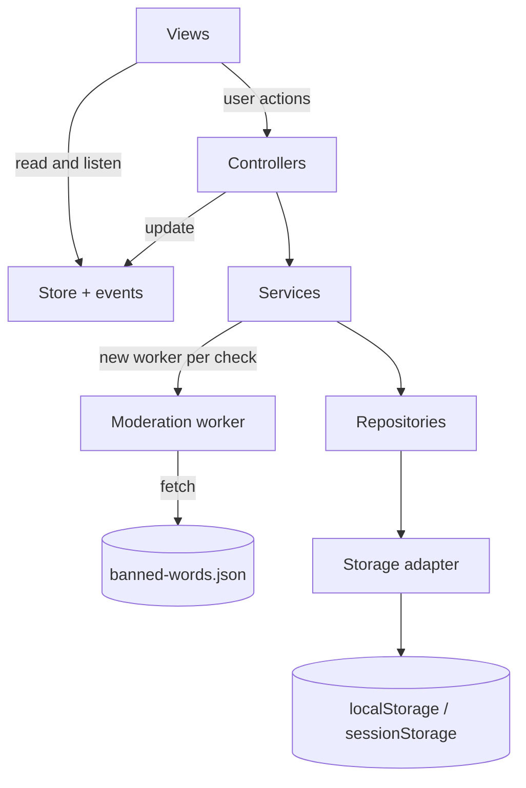
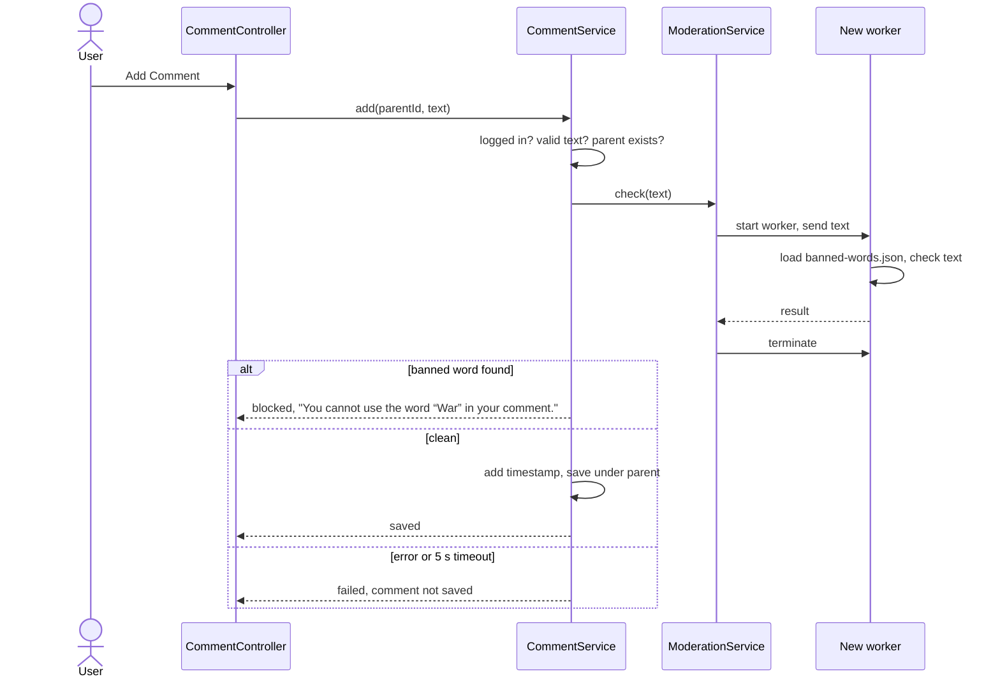

# Technical Design

How the comments page is built. What it has to do is in [the assignment](Assignment_Interview.md).

## Goals and constraints

- Meet every point of the assignment.
- Pure HTML, CSS and JavaScript (ES modules). No frameworks, no libraries, no build step.
- Safe against script injection and against broken or edited data in browser storage.
- Easy to extend: replacing localStorage with a real API should only change the data layer.
- Runs on current desktop Chrome, Edge, Firefox and Safari. It has to be served over `http(s)`,
  because module workers, `fetch` and Web Crypto do not work from `file://`.

## Architecture

| Folder           | Responsibility                                                         |
| ---------------- | ---------------------------------------------------------------------- |
| `js/views`       | Build and update the DOM. No access to services or storage             |
| `js/controllers` | Turn user actions into service calls and update the Store              |
| `js/core`        | The Store (app state), a small event bus, error types                  |
| `js/services`    | Accounts, sessions, comments and moderation. No DOM                    |
| `js/data`        | Repositories; the only code that reads and writes browser storage      |
| `js/worker`      | The moderation worker and the word matcher. Imports nothing from pages |
| `js/utils`       | Pure helpers: tree building, validation, time formatting, DOM creation |

`main.js` creates all objects and passes them in (dependency injection), so services can be tested
in Node with an in-memory storage adapter and a fake worker. Repositories and services return
Promises, so a real API could replace them without changing the callers. All constants live in
`config.js` and all UI text in `messages.js`.

## Data

Comments are stored as a flat list. Each one points to its parent, and the tree is built when the
page draws them.

| Key                             | Storage | Content                                                        |
| ------------------------------- | ------- | -------------------------------------------------------------- |
| `commentsPage.v1.users`         | local   | `{ id, username, usernameKey, passwordHash, salt, createdAt }` |
| `commentsPage.v1.comments`      | local   | `{ id, parentId, authorId, authorName, text, createdAt }`      |
| `commentsPage.v1.sessions`      | local   | `{ userId, tokenHash, createdAt, expiresAt }`                  |
| `commentsPage.v1.loginAttempts` | local   | Failed logins and lock time per username                       |
| `commentsPage.v1.session`       | session | `{ userId, token }` for the current tab                        |

Every record is validated when it is read. Unknown fields are dropped and invalid records are
skipped, so edited storage cannot break the page.

**Building the tree.** Comments are grouped by `parentId` in one pass. Top-level comments are
sorted newest first, replies oldest first, so a conversation reads from top to bottom. A reply
whose parent is missing is not shown, and a depth limit stops broken data that loops.

## Add Comment flow

The same flow is used for top-level comments and replies.

- The service runs the check itself, so no code path can save a comment without it.
- Login is checked in the service too, not only by hiding the buttons.
- The check fails closed: if the worker or the JSON file fails, or the check takes longer than
  5 seconds, nothing is saved.
- The text is read once on click, so exactly the checked text is saved.

## Banned-word matcher

The JSON file holds only the base words. All forms are generated from them in
`js/worker/wordMatcher.js`, which has no DOM access and is tested in Node.

1. **Normalise.** Remove accents, lower-case, map Cyrillic and Greek look-alike letters to Latin.
2. **Split into tokens.** Letters and digits form words; everything else separates them. Leetspeak
   inside a word is mapped back (`Russ1a` → `russia`, `w@r` → `war`).
3. **Build candidates.** Each word on its own, runs of single letters (`W.A.R`, `p u t i n`) and
   two or three neighbouring pieces joined (`Pu tin`). Pieces are not joined when they are all
   common short words, so "put in" stays allowed.
4. **Match.** A candidate is blocked only if it is exactly one of the generated forms: the word,
   plurals, nationality forms (Russian, Ukrainian) and a few endings (warfare, warlord). Stretched
   letters are collapsed first if a letter repeats three or more times (`warrrr`).

Matching is always on whole words, never inside a word, so "software", "award" and "Warsaw" pass.
A filter like this matches spelling, not meaning, so "Star Wars" or "Russian doll" are blocked.
That follows "in any form" in the assignment.

To ban another word, add it to `data/banned-words.json` and add a blocked and an allowed example
to the tests. The forms above apply automatically.

## Accounts and sessions

- Usernames: 3–20 characters, unique regardless of letter case.
- Passwords: 12–128 characters, hashed with PBKDF2-SHA-256 and a random salt (Web Crypto). Plain
  passwords are never stored.
- Login gives the same message for an unknown user and a wrong password. After 5 failed attempts
  the name is locked for 30 seconds, doubling up to 15 minutes.
- The tab keeps a random session token in sessionStorage; localStorage keeps only its hash and
  expiry time. A session ends on logout, when the tab closes, after 30 minutes without activity or
  after 8 hours. Logging out in one tab logs out the others.

Without a server, anyone with developer tools can edit storage directly. These measures protect
against other people's input, not against the owner of the browser.

## UI

- Container `width: 70%` with `margin-inline: auto`, so 15% stays free on each side. Percent and
  not `vw`, because `vw` includes the scrollbar and would cause horizontal scrolling.
- The colours, font and font size from the assignment are CSS variables in `css/tokens.css`. The
  button colours swap on hover and on keyboard focus.
- Replies are nested lists with thread lines. Indentation stops growing at level 6. Large threads
  show 3 replies and a "Show N more replies" button, and branches deeper than level 10 open on
  their own through "Continue this thread".
- One composer component is used for the main comment box and the inline reply box. It has a
  500-character counter, keeps the text when a comment is blocked and hides the message once the
  text is edited. Ctrl/Cmd + Enter posts; Enter adds a new line.
- Holding down a character key in a comment box types it once. Backspace, Delete and the arrow
  keys still repeat.
- Login and registration use a native `<dialog>`. All controls work with the keyboard and have
  labels for screen readers.

## Security

- All text goes into the page through `textContent`, using one helper, `el()`. ESLint forbids
  `innerHTML`, `insertAdjacentHTML`, `document.write` and `eval`.
- A Content Security Policy allows scripts, styles and requests only from the page's own origin.
- Stored data is validated on every read, and `__proto__` keys are ignored.

## Testing

- Unit tests with `node --test` for the matcher, validators, tree building, repositories and
  services. The matcher tests list both words that must be blocked and words that must pass.
- `tests/perf.html` draws 1 000 comments and measures the time (target: under 200 ms).
- Manual checks in the browser at 1920×1080: the assignment points, script injection attempts and
  damaged storage.
